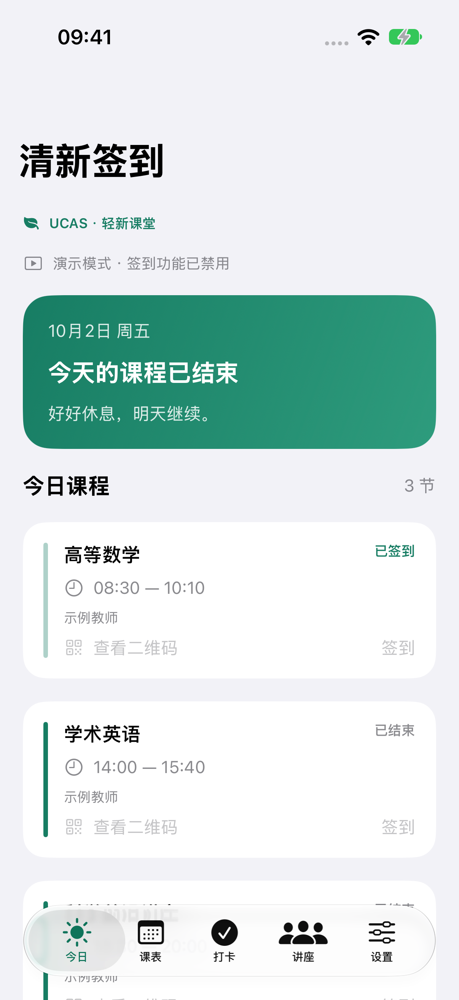
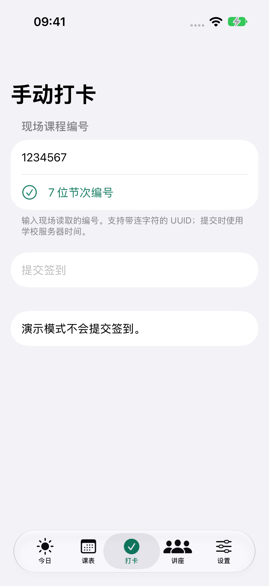
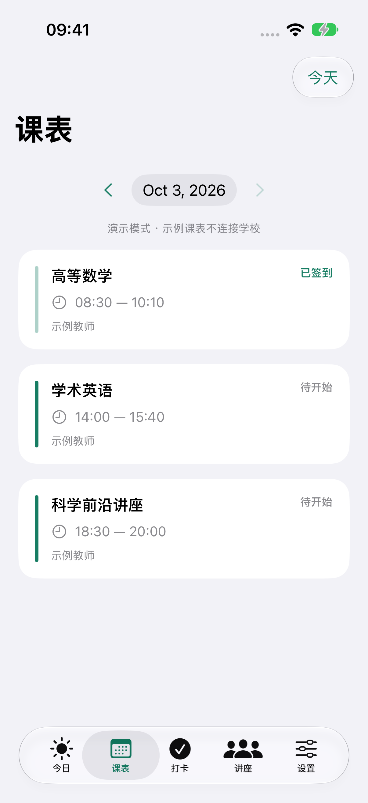

# 清新签到 · iOS 移植

原生 SwiftUI + WidgetKit 工程，支持 iOS / iPadOS 17 及以上。基于
[zhan-nine/UCAS-Sign-in](https://github.com/zhan-nine/UCAS-Sign-in) 的
`0ae6ed9d277434f37456cc7af7420d3dc2f5b13d` 移植，修改日期为 2026-10-02。
源码位于 [Vel044/UCAS-Sign-in 的 ios-port 分支](https://github.com/Vel044/UCAS-Sign-in/tree/ios-port)。

这是首版移植。真实账号登录、签到和真机通知仍需在学校服务环境中联调。

社区预览发行版和未签名 IPA 的安装、构建说明见 [`RELEASE.md`](./RELEASE.md)。

## 界面预览

以下为 iPhone 17 Pro / iOS 27 模拟器上的离线演示截图，所有签到操作均已禁用。





## 已实现

| 功能 | iOS 实现 |
| --- | --- |
| SEP 邮箱 / 轻新课堂学号登录 | 沿用原项目请求字段；会话存于 Keychain，可选保存密码用于重新认证 |
| 今日课程与任意日期课表 | 日课表和周课表回退；按北京时间解析；按账号和日期缓存 |
| 一键签到 / 手动编号签到 | 7 位节次编号、32 位 UUID；严格依据学校响应确认成功 |
| 签到二维码 | Core Image 原生生成；服务器校时、半往返时延补偿、30 秒校时有效期、最多 5 秒二维码有效期 |
| 自动签到 | **仅在 App 前台时执行**；开课前 15 分钟至开课时随机安排，最多尝试 3 次，最晚到开课后 20 分钟；支持今日 / 长期跳过 |
| 上课提醒 | 本地通知，开课前 15 分钟；须授予通知权限，且先成功同步课表 |
| 桌面小组件 | 小、中、大三种尺寸；当前 / 下一节课程；课时边界时间线；点击打开 App |
| 后台刷新 | 系统调度的 BGAppRefreshTask，仅刷新课表、缓存及提醒，不在后台提交签到 |
| 讲座预约 | 独立 WKWebView 打开已配置的 SEP / 预约系统；网页登录与 API 登录分离，网页数据不持久化 |
| 演示模式 | 离线示例课表；不联网，不提交签到 |

原 Android 版的常驻通知、精确闹钟、厂商保活和负一屏无法直接移植到 iOS。
iOS 不保证后台任务的启动时刻，小组件也受系统刷新预算限制。界面已明确标注这一差异。
讲座预告的多源聚合、新讲座巡检与 GitHub 自动更新尚未移植；讲座页当前采用学校网页登录。
参考 [Apple 后台任务文档](https://developer.apple.com/documentation/backgroundtasks) 和
[WidgetKit 刷新说明](https://developer.apple.com/documentation/widgetkit/keeping-a-widget-up-to-date)。

## 打开与构建

已提交 `Qingxin.xcodeproj`，可以直接用 Xcode 打开。要求 Xcode 15 或以上。
首次克隆先创建本机配置文件：

```sh
cd ios-app
cp Config/Local.xcconfig.example Config/Local.xcconfig
open Qingxin.xcodeproj
```

选择 `Qingxin` scheme 和 iPhone / iPad 模拟器，点击 Run。首次进入可选择「先看看演示」。
命令行验证：

```sh
swift test
xcodebuild -project Qingxin.xcodeproj -scheme Qingxin \
  -sdk iphonesimulator -destination 'generic/platform=iOS Simulator' \
  -derivedDataPath build CODE_SIGNING_ALLOWED=NO build
```

工程由 [XcodeGen](https://github.com/yonaskolb/XcodeGen) 生成。修改 targets、资源或构建设置后运行
`xcodegen generate`，同时提交 `project.yml`、生成的工程及 plist / entitlements。
应用与小组件均链接本地 `QingxinCore` Swift Package，无第三方运行时依赖。

`scripts/verify.sh` 可一键运行协议测试和模拟器编译。运行 App 状态及界面测试可在 Xcode 按
Command + U；命令行先从 `xcrun simctl list devices available` 选择设备 UUID，再运行：

```sh
xcodebuild -project Qingxin.xcodeproj -scheme Qingxin \
  -destination 'id=YOUR_SIMULATOR_UUID' \
  -derivedDataPath /private/tmp/qingxin-ios-derived \
  -parallel-testing-enabled NO -collect-test-diagnostics never \
  CODE_SIGNING_ALLOWED=NO test
```

建议把构建产物放在普通本地目录；iCloud 同步中的桌面目录可能阻塞模拟器加载测试组件。

### 真机安装

1. 在 `Config/Local.xcconfig` 填入自己的 `DEVELOPMENT_TEAM`，并设置独占的
   `QINGXIN_BUNDLE_ID` 与 `APP_GROUP_IDENTIFIER`。
2. 在 Apple Developer 账号里注册同名 App Group；主应用和 Widget target 都启用此组。
3. 连接 iPhone，在 Xcode 选择真机后运行；按系统要求信任开发者并启用开发者模式。

本仓库不包含分发证书或签名 IPA。个人免费签名账号通常不支持 App Groups；
若只调试主应用，可在本地暂时移除两个 target 的 App Group entitlement，主应用仍可使用，
小组件将无法读取共享课表。完整的小组件真机验证需要支持 App Groups 的开发者账号。

## 学校接口配置

应用内「设置 → 接口配置」支持填写：

- `apiBaseURL`：原 Android `ucas.iclass.apiBaseUrl`，保留 API 路径并以 `/` 结尾。
- `verificationURL`：原 `ucas.iclass.verifyUrlTemplate`，保留 `{0}`、`{1}`、`{2}` 等原有占位符，原样提交。
- `lectureURL`：可选，原 `ucas.sep.loginUrl` 或学校讲座系统入口。

真实主机、端口与验证模板不提交到源码。优先采用 HTTPS；学校 API 使用 HTTP 时需注意明文传输。
为兼容用户提供的校方旧接口，本工程允许 HTTP 网络请求。

私有本机构建也可以用 `Config/Local.xcconfig` 的 `QINGXIN_BOOTSTRAP` 注入配置，值为以下
JSON 的 UTF-8 Base64。Base64 仅用于构建变量传输，不是加密：

```json
{"apiBaseURL":"https://YOUR_HOST/YOUR_BASE_PATH/","verificationURL":"YOUR_ORIGINAL_TEMPLATE","lectureURL":"YOUR_LOGIN_URL"}
```

`Local.xcconfig`、构建产物、签名文件均被 Git 忽略。该配置会进入本机编译的安装包，
与 Android 安装包中的 BuildConfig 用途相同，不能视为安装包内的秘密。

本次工作区的 `Local.xcconfig` 已从上游随仓库发布的 `qingxin-signin-1.2.2-release.apk`
恢复 API 根地址、verificationUrl 和 SEP 登录入口；这些值未写入提交。
校时接口已通过一次不带账号密码的 POST 实测，返回了符合协议的服务器毫秒时间戳。

## 验证记录（2026-10-02）

- `swift test`：26 项测试全部通过，覆盖请求编码、编号校验、UUID 回退、会话缺失 / 过期、
  日 / 周课表回退、空值、签到成功条件、二维码过期、北京时间、课时边界、校时 TTL 和小组件跨天。
- Xcode 27 / iOS Simulator SDK 27：主应用与 Widget 扩展编译通过；模拟器 arm64 / x86_64 均参与构建。
- 校时端点只读联调成功；未使用真实学校账号，未提交真实签到。
- iPhone 17 Pro / iOS 27.0 runtime：2 项 App 状态回归测试和 4 项 XCUITest 全部通过，
  覆盖浏览其他日期时保留今日状态、退出登录清理数据、页面切换、编号校验和演示模式禁止签到。
  已导出并人工检查今日、课表、手动打卡及设置截图。
- iOS 设备架构下的主应用与 Widget 未签名编译通过。
- 模拟器测试采用未签名构建；App Group 共享数据、Widget 宿主及通知送达仍需签名环境验证。
- 未配置 Apple 签名团队，尚未验证真机安装、通知送达与后台刷新。
- `Config/ios-ci.yml.example` 提供 GitHub Actions 模板，可复制到 `.github/workflows/ios.yml` 启用。
  当前 GitHub OAuth 凭据没有 `workflow` scope，因此模板先随源码交付，不触发远端 workflow 写入。

## 本机数据

账号、可选密码、会话及接口配置使用 `kSecAttrAccessibleAfterFirstUnlockThisDeviceOnly` 存储，
不参与 iCloud Keychain 同步。课表缓存使用文件保护；小组件共享的快照不含账号密码、会话或 API 地址。
退出登录清除 Keychain 登录记录、课表缓存、小组件快照和待发送通知。
新安装首次启动也会清除可能由 iOS 保留的旧登录记录。

网络请求不写入日志。遇到超时或缺少成功字段时，界面不会宣称签到成功；只对明确的会话失效尝试重新认证。
周课表接口的 `STATUS` 约定在上游实现中存在分歧，本版以真实 `result` 数组为准，并以测试固定行为。

### 预览版已知的签到状态限制

当前成功提示按签到接口字段解析；如果成功字段与拒绝消息互相矛盾，可能误报成功。
本地保留的成功标记还会覆盖刷新后的课表状态，因此 App 显示不一定与学校终端记录一致。
这两种情况已用模拟数据复现，尚未在此版本修改。是否签到生效应以学校记录为准。
现有日志不保留当时的响应正文，无法事后确定某次实际操作是否触发了上述情况。

## 许可证与归属

沿用仓库根目录的 **AGPL-3.0**，保留原 `LICENSE`、`LICENSES/` 与 `NOTICE`。
原上游包括 zhan-nine/UCAS-Sign-in、lccipher/UCAS-Course-Sign-in。
协议和校时逻辑依据 Android 源码适配；iOS 界面、小组件与图标为此次新增实现。
完整许可证随 App 打包，可从「设置 → 开源许可证」阅读。
